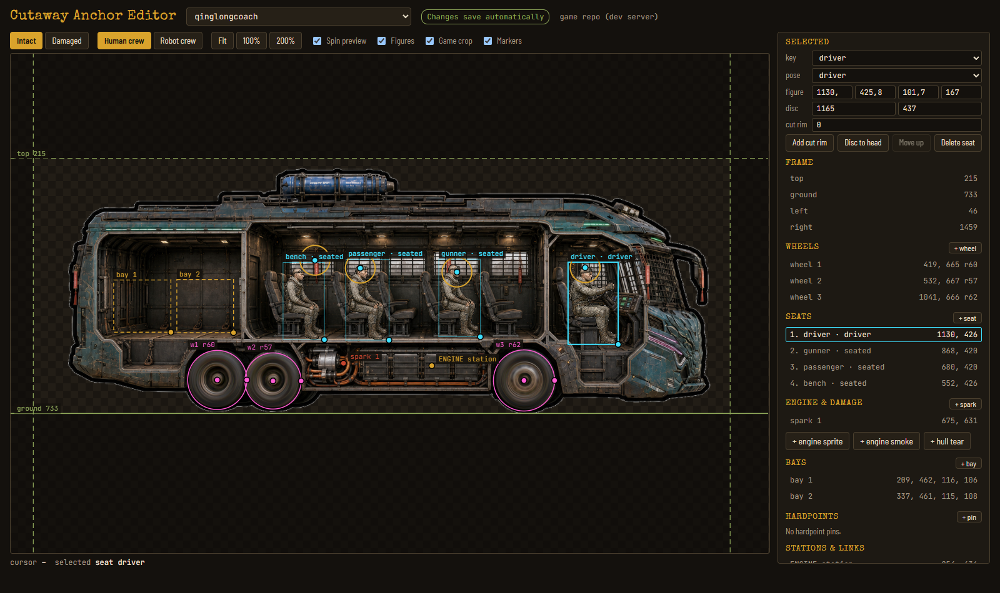

# Cutaway editor

In a road battle, clicking one of your vehicles opens its **cutaway**: the vehicle
sectioned open, crew in their seats, wheels spinning, the engine, the cargo bays and
the hardpoints marked. Your mod's vehicles can have one too. You draw the picture;
this editor places everything on it and writes the files the game reads.



> **Needs the game update after 15 October 2026.** Older builds ignore mod
> cutaways and show the vehicle's side view instead.

## What you need

- **Chrome or Edge** on a desktop computer (other browsers cannot write into a folder).
- Your mod folder with a vehicle skin, for example `levels/my_outpost/` with a
  `vehicles.json` entry `"skin": "mo-rust-hauler"`.
- The cutaway picture of that skin in the mod's `assets/` folder:

| File | What it is |
|---|---|
| `cutaway-<skin>.png` | **required.** 1536×1024, transparent background, the vehicle seen from its LEFT side facing RIGHT, the side wall cut away so the cab, seats and cargo space are visible. Leave the seats **empty**: the game draws the crew. |
| `cutaway-<skin>-damaged.png` | optional. The same picture battered, drawn over **exactly the same outline** (same size, same place). Without it a damaged hull keeps the intact picture. |

Keep the vehicle's size and position the same as its side view where you can; the
[art guide](../../.claude/skills/geargrave-outlands-mod-creator/references/art-guide.md#cutaway)
has prompts and style notes.

## Use it

1. Download this folder (`cutaway-editor.html` and the `crew/` folder next to it).
2. Double-click `cutaway-editor.html`. It opens in your browser.
3. Press **Open mod folder** and pick your mod's folder (the one with `level.json`).
   Allow the browser to edit files in it.
4. Pick a vehicle at the top. Place, by dragging on the picture:
   - **Wheels** (`+ wheel`, one per tyre): drag the centre onto the hub, the ring
     handle onto the tyre's outer edge. Turn on **Spin preview**: a correctly placed
     wheel blurs evenly; a smear means the ring is off.
   - **Seats** (`+ seat`): the first seat gets the driver, then the gunner, then the
     rest. Pick the pose (driver, seated, gunner standing, kneeling outside the cab),
     drag the figure into its seat, size it from its lower-right corner, put the
     portrait disc over the head. **Cut rim**: the red line in front of a seat that
     hides the legs behind a dashboard or a hatch rim.
   - **Hull tear**: where damage smoke and fire come out. Always set it.
   - **Engine smoke**, **sparks**, **cargo bays**, **hardpoint pins** (one per weapon
     mount), the **WHEEL** and **ENGINE** stations, the **weapon card** and the dashed
     **links** from gunner and driver: all optional.
   - **Frame lines**: `ground` sits under the tyres, `top` above the highest thing
     that must show; `left`/`right` crop the sides. **Game crop** darkens what the
     game cuts off.
5. Press **Save** (or Ctrl+S). The editor writes into your mod's `assets/` folder:
   - `cutaway_anchors.json` (all your vehicles' anchors, one entry per skin),
   - `wheel-spin-<skin>-<n>.png` and `wheel-spin-<skin>-damaged-<n>.png` (the
     spinning wheels, cut from your own picture),
   - `glow-<skin>-damaged.png` (the warning glow around a damaged hull).
6. Check the mod: level picker → **MODS** → **Re-check**, or the command line
   validator. It reports a missing picture, wheels without spin sprites and an unset
   hull tear. Then start a battle with the vehicle and click it.

The **Check** box in the editor warns about the same problems before you save.
**Human crew / Robot crew** only changes the preview; the game picks the figure from
the crew member.

## Keys

| Key | Does |
|---|---|
| arrows | nudge the selected marker by 1 (Shift: 10) |
| Del | remove the selected wheel, seat, pin … |
| Ctrl+Z | undo |
| Ctrl+S | save |
| Esc | deselect |
| Ctrl + mouse wheel | zoom |

## The file

`assets/cutaway_anchors.json` holds one entry per skin. All numbers are pixels of the
1536×1024 picture. You can edit it by hand; the editor keeps fields it does not know.

```json
{
  "mo-rust-hauler": {
    "top": 300, "ground": 960, "left": 60, "right": 1470,
    "wheels": [[381, 864], [1218, 853]], "wheelRadius": 102, "wheelRadii": [98, 106],
    "engine": [], "engineSmoke": [1300, 700], "engineSparks": [[1280, 740]],
    "hullTear": [520, 640],
    "bays": [[200, 600, 220, 140]],
    "hardpoints": [[900, 380]],
    "seats": [
      {"key": "driver", "pose": "driver", "figure": [1080, 520, 110, 180], "clipY": 700, "head": [1120, 540]},
      {"key": "gunner", "pose": "gunner", "figure": [880, 300, 120, 222], "clipY": 0, "head": [920, 322]}
    ],
    "stations": {"drive": [1180, 560]}
  }
}
```

| Field | Meaning |
|---|---|
| `top`, `ground`, `left`, `right` | the part of the picture the game shows; `ground` lands on the panel's lower edge |
| `topWithCard` | a higher `top` used while the weapon card is shown above the vehicle |
| `wheels`, `wheelRadii` | tyre centres and radii; `wheelRadius` is their average |
| `tracked` | `true` for tracked hulls: no spinning wheels, the `wheels` are only damage markers |
| `engine` | `[x, y, w, h]` of the game's swappable engine sprite, `[]` = your picture's own engine |
| `engineSmoke`, `engineSparks`, `hullTear` | where smoke, sparks and fire come out (`[0, 0]` = none) |
| `bays` | `[x, y, w, h]` per cargo bay; the cargo's icon is drawn inside |
| `hardpoints` | one pin per weapon mount, in mount order |
| `seats` | in fill order: `key` (driver, gunner, passenger, bench …), `pose` (driver, seated, gunner, kneel), `figure` `[x, y, w, h]`, `clipY` (cut rim, 0 = none), `head` (portrait disc centre) |
| `stations` | `drive` and `engine` badges |
| `weaponCard`, `weaponLink`, `driveLink` | the weapon card's centre; the dashed links as three points each (from, bend, to) |

A skin the base game already has a cutaway for keeps the game's own; pick a new skin
name for your vehicle.
